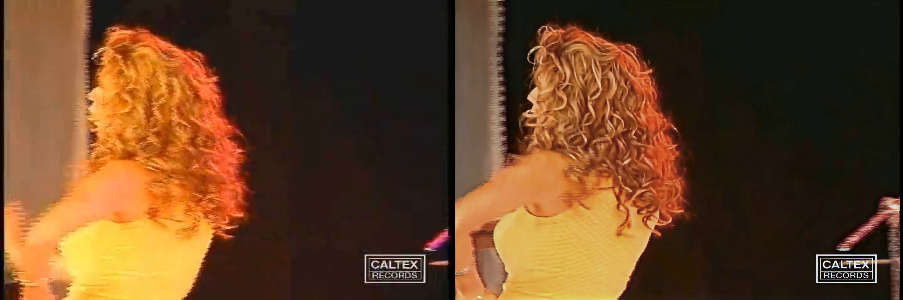

# 🎬 Old Video Enhancer

Restore old TV / VHS / low-quality videos with AI in Google Colab: sharper detail, corrected colors, correct shape and smooth 60 fps motion, all controlled with checkboxes, dropdowns and sliders.

[](https://colab.research.google.com/github/ryanparsa/video-enhancer/blob/main/video_enhancer.ipynb)

## What it does

```
original video ─► SeedVR2 (AI restoration, up to 1080p/1440p)
               ─► audio + aspect-ratio fix
               ─► color correction
               ─► RIFE (doubles the frame rate, e.g. 30 → 60 fps)
               ─► save to Google Drive / download
```

| Step | Tool | Why |
|---|---|---|
| AI restoration | [SeedVR2](https://github.com/ByteDance-Seed/SeedVR) via [ComfyUI-SeedVR2_VideoUpscaler](https://github.com/numz/ComfyUI-SeedVR2_VideoUpscaler) CLI | Generative model that rebuilds missing detail and keeps it consistent across frames |
| Shape fix | ffmpeg | 720×480 sources often have non-square pixels; without this people look ~12% too wide |
| Color | ffmpeg `colorbalance` + `eq` | Removes the orange cast of old stage lighting, keeps the mood |
| Smooth motion | [RIFE v4.26](https://github.com/hzwer/Practical-RIFE) via [ccvfi](https://github.com/EutropicAI/ccvfi) | Interpolates in-between frames; camera cuts are detected and never blended |

## Sample result

23-second test clip, 3:47 to 4:10 of the video (720×480 TV recording → 1620×1080, SeedVR2 3b on a Colab A100). Original on the left, final on the right:



### Original (720×480, as downloaded)

https://github.com/user-attachments/assets/f070ff2e-ad82-4599-90e1-533583a51b8e

### 1. AI restoration + audio

https://github.com/user-attachments/assets/eb1c43a5-740c-4631-a643-26258dc6669b

### 2. Color correction

https://github.com/user-attachments/assets/55843591-8ed7-4e97-9f2c-e85ba7370e99

### 3. Smooth motion (RIFE, 60 fps)

https://github.com/user-attachments/assets/1462ee4b-f8dd-4565-8440-7b7e74a685f0

<sub>Sample footage: "Kabootare Del" by Susan Roshan, © Caltex Records. Used only to demonstrate the tool; not covered by this repo's license.</sub>

## Quick start

1. Click **Open in Colab** above.
2. **Runtime → Change runtime type → A100 GPU** (L4 also works, slower). The free T4 is too small for SeedVR2.
3. Put your video in Google Drive and set its path in **2.1 Load the video** (or choose *Upload from computer*).
4. Leave **Test mode** on and run **Runtime → Run all**. Check the comparison in **5.1**.
5. Happy with it? Turn **Test mode** off, tick **5.3 Shut down**, and **Run all** again for the whole video.

## Settings

| Section | Setting | Default | Notes |
|---|---|---|---|
| 2.2 | Test mode | on | Processes only a short clip. Off = whole video |
| 2.2 | Test start / seconds | 30 / 5 | In test mode, clip time 0 = *Test start* in the original |
| 2.2 | Deinterlace | off | Only if you see horizontal comb lines on movement |
| 3.1 | Model | 3b | `3b` = faithful & faster · `7b` = more detail, invents more, slower |
| 3.1 | Resolution | 1080 | Output height. Above 1080 rarely helps for SD sources |
| 3.1 | Batch | 33 | Frames processed together. Higher = steadier picture, more GPU memory |
| 3.1 | Chunk | 330 | Frames per chunk. Saving holds several copies of each frame (~45 MB per 1080p frame at peak): 1,800 frames at once crashed an 83 GB runtime. 330 ≈ 15 GB |
| 3.1 | VAE tile | 1536 | Only ~5% faster than 1024 (VAE decode is compute-bound) · uses ~34 GB on A100 40GB · 0 = no tiling, likely out of memory · out of memory → 1024 |
| 4.1 | Fix aspect | on | Automatic, based on the source's display aspect ratio |
| 4.2 | Warm fix / saturation / brightness / contrast | 0.10 / 0.88 / 0 / 1.0 | Set warm fix to 0 to keep the original colors |
| 4.3 | Smooth FPS / scene cut | on / 35 | Ghosting at cuts → lower · jumps in fast motion → higher |
| 5.2 | Save to Drive / download | on / off | Output name is automatic, e.g. `my_video_3b_1080p_full.mp4` |
| 5.3 | Shut down | off | Turn on before a long run so Colab stops using compute units at the end |

## Speed & cost (A100, 720×480 → 1080p, 3b model)

| | Per 33-frame batch | 5½-minute video (~10,000 frames) |
|---|---|---|
| VAE tile 1024 | ~29 s (encode 7.4 · DiT 4.1 · decode 17.6) | ~2.5 h · ~13 compute units |
| VAE tile 1536 | ~28 s (encode 7.1 · DiT 4.1 · decode 16.5) | ~2.3 h · ~12 compute units |
| RIFE 2× | n/a | ~5–10 min |

A100 uses about 5.3 compute units per hour (≈ $0.53 on Pay As You Go). Measured on one test run; your numbers will vary.


## Troubleshooting

| Problem | Fix |
|---|---|
| `CUDA out of memory` | VAE tile → 1024, then Batch → 21 |
| "Session crashed after using all available RAM" | Chunk too large, use 330 (or 165). Installed packages and downloaded models survive the crash; re-run from 1.1 |
| `GPU too small` warning | Switch the runtime to A100 or L4 |
| "It invented a new shot" | Check timing: in test mode, clip second *t* = original second *Test start + t* |
| Ghost/double image at camera cuts | Lower the scene-cut slider in 4.3 |
| No output video found | Scroll up in 3.1 for the real error message |

## Credits & license

This repo is Apache-2.0. It uses SeedVR2 (ByteDance Seed, Apache-2.0), the SeedVR2 CLI by NumZ / AInVFX, RIFE (hzwer) and ccvfi (EutropicAI). See their repos for their licenses.

The code is Apache-2.0; the files in `samples/` remain the property of their copyright holder. Only process videos you have the right to use.
